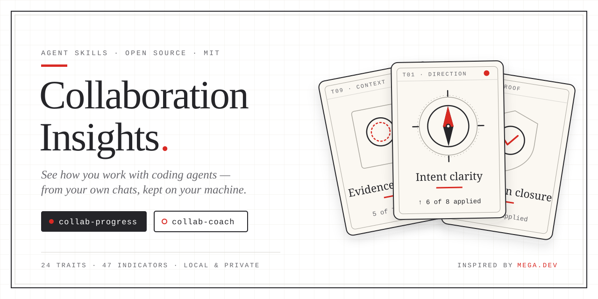

# Collaboration Insights



Two agent skills that show you **how you work with coding agents**, using your
own local chat history. Nothing is uploaded.

| Skill | What it does |
|---|---|
| [`collab-progress`](skills/collab-progress/SKILL.md) | Reviews your past agent chats against a 24-trait, 47-indicator collaboration rubric. It keeps private statistics, saves dated reports that show changes since the last run, and builds a local trait-card dashboard. |
| [`collab-coach`](skills/collab-coach/SKILL.md) | Reviews the current chat when you ask. It names your strengths and up to three missed opportunities, cites the exact messages, and suggests one small experiment for your next task. |

Supported agents: **Claude Code**, **Codex** and **pi**. They are also supported
when they run inside **T3 Code** or **herdr**. For other agents, a guided
onboarding helps you write your own adapter
([harness-onboarding.md](skills/collab-progress/references/harness-onboarding.md)).

## Inspiration and credits

This project is inspired by **[MEGA.dev](https://mega.dev/)** and its course
about working with AI agents. It is based on the
**[MEGA Assessment challenge](https://mega.dev/challenge.md)**. That challenge
scores your agent history against 24 collaboration traits, such as intent
clarity, delegation judgment and verification closure.

These skills take the same idea and make it **fully local and ongoing**:

- You can rerun the assessment over time and compare each run with the last.
- You get per-chat coaching on request.
- A dashboard shows your trait cards.
- No data leaves your machine.

Thanks to the MEGA.dev team for the idea and the trait framework.

> This is an independent community project. It is **not** affiliated with or
> endorsed by MEGA.dev, and it is not an official course assessment. "MEGA" and
> "MEGA.dev" belong to their owners.

## Requirements

- **Python 3.11 or later.** All commands need it. The skills use only the
  standard library, so there is nothing to `pip install`.
- **Node.js 18 or later** (optional). You need it only for the dashboard server
  (`serve.mjs`) and the `.mjs` tests.

## Installation

Copy or symlink each folder from `skills/` into your agent's skills directory.
For example:

```bash
# Claude Code
cp -r skills/collab-progress skills/collab-coach ~/.claude/skills/

# Codex and other agents that read ~/.agents/skills
cp -r skills/collab-progress skills/collab-coach ~/.agents/skills/
```

Keep the two folders next to each other. `collab-coach` uses
`../collab-progress` for its rubric and transcript reader.

On first use, the agent checks your Python and asks you where to keep your
private data. Then it runs `progress.py setup`. To check your environment
yourself:

```bash
python -X utf8 skills/collab-progress/scripts/progress.py doctor
```

## Usage

Ask your agent in plain language:

- *"Coach me on this conversation"* or *"What could I have done better here?"*
  runs **collab-coach**.
- *"Refresh my collaboration statistics"* or *"Show my progress"* runs
  **collab-progress**.

Dates and weekly charts use your system's local time. To pin a zone, set
`COLLAB_PROGRESS_TZ=Europe/Berlin` (any IANA name). On Windows this needs the
`tzdata` Python package; without it, the skill falls back to local time.

To view the dashboard, start the local server, which binds to 127.0.0.1 only:

```bash
node skills/collab-progress/scripts/serve.mjs --open
```

## Privacy

- The skills **read** your agents' transcript folders. They never edit or upload
  them.
- All results stay in the data folder you choose. That folder gets a
  `.gitignore` of `*` and a `PRIVATE.txt` notice. On POSIX systems it also gets
  owner-only permissions.
- Before you share your copy of this repository, make sure that no `data/`
  folder and no `config.json` file is committed. This repository's
  `.gitignore` excludes both.
- Redaction of secrets in review packets is **best effort**. Treat everything in
  the data folder as private.

## Tests

```bash
cd skills/collab-progress/scripts
python -X utf8 -m unittest test_harnesses test_setup test_admin test_multi test_progress_claude test_progress_codex test_presentation
node test_dashboard.mjs && node test_serve.mjs
```

## Disclaimer

This software is provided **"as is", without warranty of any kind**. You use it
**at your own risk**. The authors and contributors are **not liable** for any
damage, data loss, system breakage, security issue or other harm that comes from
using, misusing or being unable to use this software. That includes any actions
an AI agent takes while it follows these skills.

Read the skill files before you install them. Review every command your agent
proposes before you approve it. See [LICENSE](LICENSE) for the full terms.

## License

[MIT](LICENSE)
